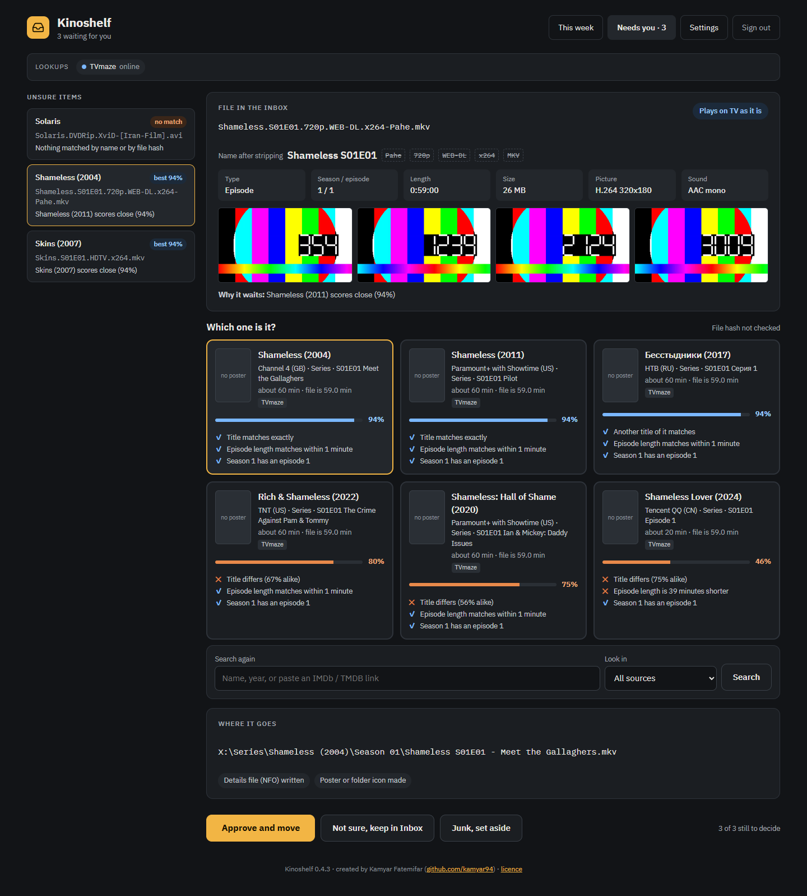
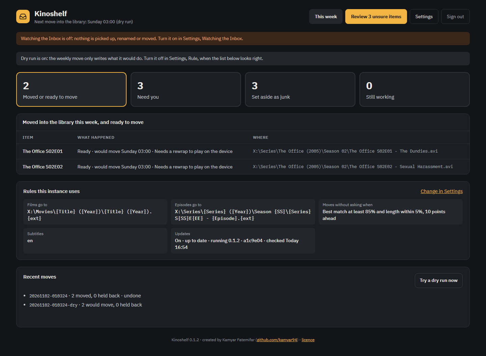
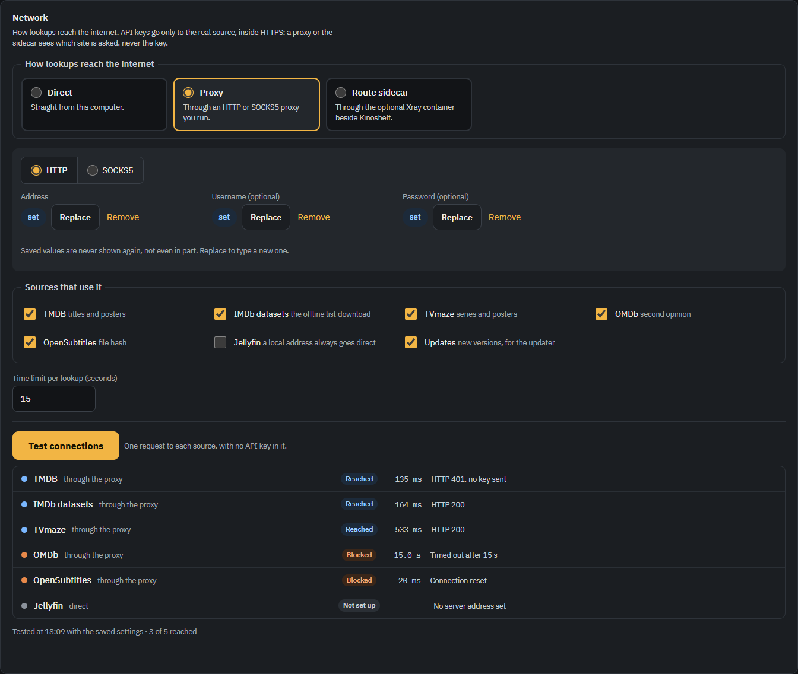
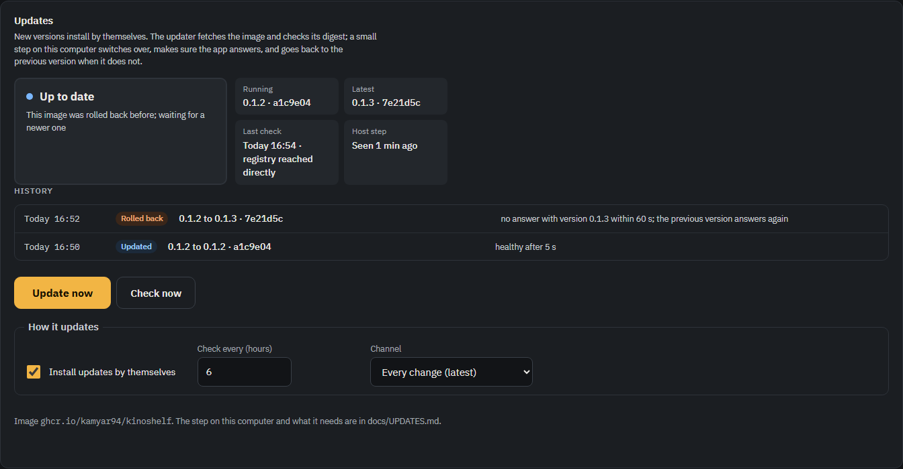
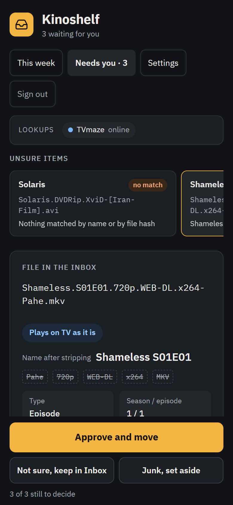

# Kinoshelf

A self-hosted inbox for new films and episodes. Drop a video into the Inbox folder and Kinoshelf:

1. waits until the copy has finished;
2. strips release junk from the name (`Solaris.DVDRip.XviD-[Site].avi` becomes "Solaris") and reads
   the title, year, season and episode;
3. asks several sources who it is (TMDB, an offline copy of IMDb's datasets, TVmaze, OMDb, the
   OpenSubtitles file hash, and your Jellyfin library), and scores each match on title (original and
   alternative titles included), year, running time against the real file length, and file hash;
4. gives it its final name inside the Inbox, from naming templates you set, and runs optional hooks
   (device check and rewrap, subtitles, NFO, poster or folder icon);
5. once a week, moves everything it is sure about into the library and asks your media server to
   look at just those folders.

Whatever it is not sure about waits on a one-screen review page: the file with what was stripped from
its name, its facts, four still frames, the matches with the checks behind each score, a search box
that also takes a pasted IMDb or TMDB link, the destination path, and three buttons: **Approve and
move**, **Not sure, keep in Inbox**, **Junk, set aside**. A second page shows the week, and a third
edits every setting. The pages work at phone width.

**It never deletes.** Junk, replaced files and emptied folders go to a set-aside folder on the same
drive for you to empty. Every move is written to a journal with an undo file.

## Screenshots

The review page: three versions of "Shameless" fit the file equally well, so the episode waits for
you. Each card shows the checks behind its score; the destination path follows the card you pick.



| This week | Settings > Network | Settings > Updates | On a phone |
|---|---|---|---|
|  |  |  |  |

Taken from a demo instance: generated test-pattern videos, live TVmaze lookups (no other keys),
posters left out. The Network panel went through a local test proxy that blocks two sources on
purpose; the Updates history is from the end-to-end test, where a broken release was rolled back.

## Contents

- [Screenshots](#screenshots)
- [Quick start](#quick-start)
- [Folders and how the app sees them](#folders-and-how-the-app-sees-them)
- [Reaching the app](#reaching-the-app)
- [The weekly move](#the-weekly-move)
- [Sources and keys](#sources-and-keys)
- [Network](#network)
- [Updates](#updates)
- [Hooks](#hooks)
- [Backups](#backups)
- [Development](#development)
- [Licence](#licence)

## Quick start

You need Docker with Compose v2.

```bash
git clone https://github.com/kamyar94/kinoshelf.git
cd kinoshelf
cp .env.example .env                              # set PUID, PGID, TZ
cp compose.media.example.yml compose.media.yml    # list your drives or folders
sh scripts/start.sh                               # Windows: .\scripts\Start.ps1
```

`scripts/start.sh` builds the image (the first time, or with `--build`), starts the app and the
updater, and prints the **setup code** from the log.
Open http://127.0.0.1:8484, enter the code, and create your account (one admin; the code works
once). Then, in **Settings**:

1. **Folders**: for each mounted folder, how it looks to you (`M:\` or `/srv/media`) and where it
   is inside the container (`/media/one`). Then the Inbox folder(s).
2. **Naming**: your templates. The preview under each one shows a sample result.
3. **Lookup sources**: a free TMDB key gives the best results. IMDb and TVmaze need no key.
4. **When files move without asking**: the confidence rule. **Dry run** is on at first: the weekly
   move only writes what it would do. Turn it off when the dry runs look right.
5. **Desktop shortcut**: the address you use, then download a `.url` shortcut for the desktop.

Updates are on: set up the small host step from [docs/UPDATES.md](docs/UPDATES.md) (one cron line or
scheduled task) and new versions install by themselves.

The data folder `./data` holds the database, your settings and keys, the journals and cached frames
and posters. It must be writable by the PUID user.

## Folders and how the app sees them

Templates and the pages use paths the way you see them (`M:\Movies\...`), so the paths you type are
the same ones your media server knows. Settings > Folders maps each one to the container mount:

| Looks like | Inside the container | compose.media.yml |
|---|---|---|
| `M:\` | `/media/m` | `- /mnt/m:/media/m` (Docker in WSL) or `- M:/:/media/m` (Docker Desktop) |
| `/srv/series` | `/media/series` | `- /srv/series:/media/series` |

Each Inbox gets three working folders: `_Needs review`, `_Working` (being finished by hooks, already
under the final name) and `_Ready` (waiting for the weekly move), mirroring the final paths so you can
see where every file will go. Keep an Inbox on the same drive as most of its library: moves within a
drive are instant renames. Moves across drives are copied, read back and compared before the original
goes to the set-aside folder.

The watcher polls instead of waiting for change events, because a Linux container is not told about
files that Windows writes into a mounted drive. A file counts as arrived when its size, time stamp
and last 64 KB have not changed for two minutes (the timings are under `watcher` in
`data/config.yml`).

## Reaching the app

Nothing is published by default. Pick one or more in `.env`:

- **On the host or through SSH**: add `compose.local.yml` to `COMPOSE_FILE`. The app listens on
  `127.0.0.1:8484`. From another computer: `ssh -N -L 8484:127.0.0.1:8484 you@host`, then open
  http://127.0.0.1:8484.
- **On the home network**: add `compose.lan.yml` and set `LAN_IP`.
- **From anywhere, through a Cloudflare Tunnel**: set `COMPOSE_PROFILES=tunnel`, put the tunnel token
  in `cloudflared.env`, and route the tunnel's public hostname to `http://app:8484`. Because this app
  moves files, it must also sit behind **Cloudflare Access**:
  1. In Cloudflare Zero Trust, add a self-hosted Access application for the hostname, with a policy
     that allows only your email, by one-time code.
  2. Copy the team domain (`your-team.cloudflareaccess.com`) and the application's audience (AUD)
     tag into `.env` as `KS_CF_ACCESS_TEAM` and `KS_CF_ACCESS_AUD`.

  The app checks the Access token on every request that came through Cloudflare and refuses any
  without a valid one. Without these two settings it refuses all tunnelled requests, and
  `scripts/start.sh` will not start the tunnel. You still sign in to the app itself.

**Filtered or unreliable internet.** A tunnel from a network that filters traffic may be slow, cut,
or blocked. The app does not depend on it: it keeps working on the host and the LAN, lookups that
fail are retried later (items show as "Still working"), and the IMDb copy works offline. If the
IMDb download is blocked, fetch `title.basics.tsv.gz` and `title.akas.tsv.gz` from
https://datasets.imdbws.com elsewhere and put them in `data/imdb/`. When lookups themselves are
blocked, see [Network](#network).

The container runs as your user with a read-only root filesystem, no Linux capabilities, no new
privileges, memory, CPU and process limits, and pinned image versions. The tunnel connector is the
only container that reads the token, and the app reaches the internet only for lookups.

## The weekly move

At the day and time in Settings, every item in `_Ready` that still meets the rule moves into the
library. Items you approved on the review page always move. A destination that already exists is
never overwritten: the item comes back to the review page, where you can choose to replace the old
file (it goes to the set-aside folder). After the move, Jellyfin is told the changed folders only.

Each run writes `data/journal/<run>.jsonl` (every step) and `data/journal/<run>.undo.json`. To put a
run back: the **Undo this run** button on the week page, or

```bash
docker compose exec app kinoshelf undo 20261108-030000
```

Other commands: `kinoshelf move --dry-run`, `kinoshelf move --for-real`,
`kinoshelf set-password <name>`, `kinoshelf imdb-update`, `kinoshelf backup`.

## Sources and keys

| Source | Key | What it adds |
|---|---|---|
| TMDB | free, from themoviedb.org | titles, original and alternative titles, running times, episodes, posters |
| IMDb datasets | none; personal non-commercial use | offline search by title and original title; works without internet |
| TVmaze | none | series, episode titles and lengths |
| OMDb | free tier | a second opinion on films and episodes |
| OpenSubtitles | free API key | identifies the exact file by its hash (no download quota used) |
| Jellyfin | an API key from your server | spots titles you already have |

Keys are stored only in `data/config.yml` (mode 600) and are never shown again on the page.
This product uses the TMDB API but is not endorsed or certified by TMDB. TVmaze data is CC BY-SA 4.0.

## Network

Settings > Network picks how lookups reach the internet: **Direct**, through an HTTP or SOCKS5
**Proxy** (with an optional username and password), or through the optional **Route sidecar**, an
Xray container beside the app (compose profile `route`) for networks where the way out is a VLESS,
VMess, Trojan or Shadowsocks server. You choose which sources take that route; Jellyfin stays direct
unless you say otherwise. **Test connections** tries each source once, without an API key, and shows
reached or blocked with the time and a short reason, such as a DNS answer that points to a private
address, a connection reset, a time-out or an HTTP status.

The proxy's address, username and password are write-only on the page (it shows only that they are
set), and they stay out of the log, hook jobs and backups. The sidecar's server details live only in
`route/config.json` on the host, which the app never reads. Details in
[docs/NETWORK.md](docs/NETWORK.md).

## Updates

Every change pushed to `main` builds a signed image on GitHub's container registry. The `updater`
service checks it every few hours (or when you press **Check now** or **Update now** in Settings >
Updates), downloads it by digest and checks every part. A host step run by a timer
(`scripts/update/apply.sh`) loads it, refuses it when it cannot carry out your current settings, keeps
the running image as the previous one, restarts, makes sure
the app answers with the new version, and goes back to the previous image and settings when it does
not. Every update is written to `data/update/journal.jsonl` and shown in Settings. No container gets the
Docker socket. Off by one switch; details, the security reasoning and the host step for Linux, WSL and
Docker Desktop in [docs/UPDATES.md](docs/UPDATES.md).

## Hooks

Optional steps run as hooks, each one a **command** inside the container, an **http** service, or a
**folder** where the app leaves a job file and another program (for example a Windows script on the
host) answers with a result file. The shipped hooks check playback against your device profile (and
can rewrap or convert), fetch subtitles with subliminal in your language order, write NFO files, and
save posters. The protocol is in [docs/HOOKS.md](docs/HOOKS.md).

## Backups

```bash
sh scripts/backup.sh        # Windows: .\scripts\Backup.ps1
```

writes `data/backups/kinoshelf-<time>.tar.gz` with an online copy of the database, the settings
(with keys) and the journals. Copy it somewhere only you can read.

## Development

```bash
python -m venv .venv && . .venv/bin/activate
pip install -e ".[dev,subtitles]"
sh scripts/fetch-fonts.sh
KS_DATA_DIR=./data kinoshelf serve --host 127.0.0.1
pytest
```

The tests use small generated videos (ffmpeg test patterns) and recorded API answers; they never
touch real media or call real services. Tests that need ffmpeg are skipped when it is missing.

## Licence

Created by Kamyar Fatemifar (https://github.com/kamyar94). Source-available under the
**KF Source-Available License 1.0 (KF-SA-1.0)**: you may read it, keep a copy, fork it on GitHub and
run it privately for your own non-commercial use. Hosting it for others, changing it, sharing a
changed version or commercial use need written permission. See [LICENSE.md](LICENSE.md) and
[LICENSING.md](LICENSING.md) for the full terms and third-party licences.
